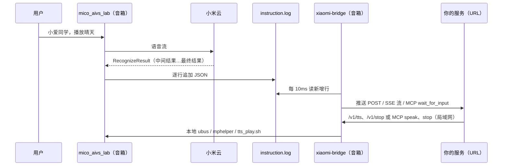

# 研究：刷机音箱上的 xiaomi-bridge

分支：`research/xiaomi-bridge`。目的：评估在刷机后的小爱音箱上运行一个桥接程序，**把识别出的用户语音实时推送到指定 URL**，以及能否在音箱本地**播放 TTS / 打断播放**。

> 状态：代码在本机用模拟日志和模拟命令跑通（`go test`、二进制冒烟）；**未在真机上运行**。所有设备行为来自下列开源项目的源码与 issue，标注了来源；第 7 节是真机验证清单。

## 目标设备与适配边界

- 用户已确认自有音箱型号为 **L06A**；固件版本尚未确认。
- 目标是在自有音箱上实现低延迟用户输入获取、接入自托管 Agent、本地播放回复与打断，而不只是通过小米云对话记录轮询控制音箱。
- 当前桥接程序尚未在 L06A 上验证。本文引用的 LX06 / OH2P SSH 补丁与刷机教程不代表支持 L06A；不得直接混刷。L06A 的 SSH 入口、日志路径、播放命令和启动方式需要分别确认。

### 同型号参考：L06A-patch

主要参考项目：[xuys2025/L06A-patch](https://github.com/xuys2025/L06A-patch)。我们的产品目标与其类似：复用 L06A 的原厂唤醒和音频硬件，让可配置的助手接管后续语音会话，并降低响应延迟。

根据该项目 README，其实现保留原厂唤醒与六麦克风前端，使用豆包流式 ASR、OpenAI 兼容 LLM 接口和原厂 TTS，另有连续对话、音乐控制、灯环反馈、网页配置与 SSH 更新。以上为参考项目的功能说明，不代表 vox-mi-agent 已实现或已验证这些能力。

当前架构差异：参考项目让音箱上的 Go 助手管理会话并调用云端 ASR / LLM；我们的现有实现是音箱侧桥接输入与播放控制，Agent 和工具编排保留在自托管 vox-mi-agent。当前 bridge 读取小米云识别结果日志，不等于已经接入独立流式 ASR。连续对话、唤醒接管和灯环反馈可作为后续设计参考，不在此处宣称完成。

适配与刷机证据：

- 参考项目声明适配 **L06A / AS06 VER0106 / Amlogic A113X**，目标程序为 Linux ARMv7；其混合固件基于原厂 **1.88.221 的 system1**。用户设备的 PCB 与固件版本仍需核对。
- 仓库提供源码、补丁和维护脚本，**不提供原厂固件或可直接通刷的成品镜像**，需要自己的分区备份和恢复方式。
- [USB-only 单槽试刷方案](https://github.com/xuys2025/L06A-patch/blob/main/docs/build/USB_ONLY_FLASH_PLAN.md) 记录了该作者设备通过 Micro-USB WorldCup 模式写非活动 system1、回读校验、切槽与 USB 回滚的流程。这里的 USB-only 不等于免拆机：该文档没有证明用户设备可从外部接口接入，也不是纯 Wi-Fi 开启 SSH 的教程。
- 文档里的镜像哈希、长度和槽位版本是作者特定设备的历史记录，不能直接套用到我们的音箱或新构建镜像。L06A 已有公开改造参考，但我们的首次 SSH 入口、USB 接入条件和恢复方案尚未实机确认。


## 1. 结论

| 问题 | 结论 |
|---|---|
| 能否实时拿到用户说的话 | 能。小爱语音服务 `mico_aivs_lab` 把云端下发的每条指令逐行写入 `/tmp/mico_aivs_lab/instruction.log`，其中 `SpeechRecognizer.RecognizeResult` 就是识别文本（含说话过程中的中间结果）。轮询该文件即可，不经小米云对话记录接口 |
| 推送延迟 | 本机冒烟：日志写入 → URL 收到 ≈ 11 ms（10 ms 轮询 + 局域网 POST）。真机多出的是 ARM 上的读文件与网络，预计仍在几十毫秒内（未实测） |
| 对外形式 | 一个端口（默认 4390）、HTTP Basic 认证（默认 `admin` / `xiaomi-bridge`）：REST + SSE 流 + MCP；推送地址、认证等通过 `PUT /v1/config` 设置并写入配置文件，重启自动读取 |
| 能否本地播放 TTS | 能，两种：① `ubus call mibrain text_to_speech`（非阻塞，由小爱自己的播放器播放）；② `/usr/sbin/tts_play.sh`（阻塞，合成到文件后由 `miplayer` 播放） |
| 能否打断**我们自己的** TTS | 能。阻塞 TTS：杀掉 `tts_play.sh` **及其子进程 `miplayer`**（bridge 用独立进程组一次杀掉）；非阻塞 TTS：`mphelper pause`（社区反馈"不一定可靠"） |
| 能否打断**小爱原生**回答 | 只能尽力而为。重启 `mico_aivs_lab` 在原生回复**开始播放前**有效、开始后在 LX06 上无效；可靠做法是先 `pause` 再播放、并在每句前再 `pause` |

## 2. 原理



- 识别仍由小米云完成；bridge 省掉的是「云端写对话记录 + 轮询间隔 + 控制指令绕云」三段。
- 日志格式来源：Open-XiaoAI `packages/client-rust/src/services/monitor/instruction.rs`（结构体定义）与 `examples/migpt/migpt/xiaoai.ts`（只取 `is_final` 的 `results[0].text`）。open-speaker-llm/xiaomi_ai_llm 在 S12A 的 boot1 固件上也确认识别文本写入该文件。
- 文件被截断（大小变小）或被替换（inode 变化，服务重启）时从头读；启动时跳过已有内容，不重放历史。

## 3. 代码

| 路径 | 内容 |
|---|---|
| `cmd/xiaomi-bridge/` | 命令行入口（只有 `-config`、`-listen`、`-log` 三个参数，都有默认值） |
| `internal/xiaomibridge/tail.go` | 轮询式 tail（截断、替换、文件尚未生成、半行） |
| `internal/xiaomibridge/instruction.go` | 解析指令行与识别结果 |
| `internal/xiaomibridge/config.go` | 配置文件：默认值、部分更新、校验、原子写入（0600） |
| `internal/xiaomibridge/hub.go` | 最新输入 + 流式订阅 + 长轮询等待 |
| `internal/xiaomibridge/push.go` | 单协程按序推送；每次发送时读取当前配置；不重试（迟到的提问比丢失更糟），队列满丢弃 |
| `internal/xiaomibridge/device.go` | 本地命令：不经 shell 执行，参数原样传递；TTS 进程组管理 |
| `internal/xiaomibridge/server.go` | HTTP API（Basic auth） |
| `internal/xiaomibridge/mcp.go` | MCP 服务（官方 go-sdk，Streamable HTTP，无状态）与描述文件 |

构建：`make bridge` → `dist/xiaomi-bridge_linux_armv7`（LX06 / OH2P，Open-XiaoAI 用 `armv7-unknown-linux-gnueabihf`）与 `dist/xiaomi-bridge_linux_arm64`（如 S12A 等 aarch64 机型）。约 9.5 MB 静态二进制（其中 MCP SDK 约 2 MB），无依赖。上机前用 `uname -m` 确认架构。

## 4. 默认值与配置

开箱即用，不需要任何参数：

| 项 | 默认 |
|---|---|
| 端口 | `:4390`（所有网卡），`-listen` 可改 |
| 账号 / 密码 | `admin` / `xiaomi-bridge`（HTTP Basic）；未修改时启动日志告警，`/v1/status` 的 `default_credentials` 为 `true` |
| 配置文件 | `/data/xiaomi-bridge/config.json`（`/data` 是持久分区），`-config` 可改；首次 `PUT /v1/config` 时创建 |
| 设备名 | 主机名 |
| 推送 | 关闭（`push.url` 为空） |

`PUT /v1/config` 做部分更新（只传要改的字段），校验通过后先写文件再生效，**立即生效、重启后自动读取**；未知字段、非 http(s) URL、少于 6 位的密码、含 `:` 的用户名都返回 400 且不写文件。`GET /v1/config` 不返回密码和推送 token。文件损坏时拒绝启动，不会悄悄回到默认密码。

```sh
curl -u admin:xiaomi-bridge -X PUT http://<音箱IP>:4390/v1/config -d '{
  "device": "客厅",
  "auth": {"password": "<新密码>"},
  "push": {"url": "http://<NAS>:<端口>/<路径>", "token": "<接收方校验用>", "partial": false}
}'
```

配置文件内容（密码明文保存，文件权限 0600；音箱上本来就是 root）：

```json
{"device":"客厅","auth":{"username":"admin","password":"…"},"push":{"url":"http://…","token":"…","partial":false}}
```

## 5. API

除 `GET /healthz` 外都要 HTTP Basic 认证（`curl -u admin:<密码>`），失败返回 401。

| 请求 | 作用 |
|---|---|
| `GET /v1/config` / `PUT /v1/config` | 读取（不含密钥）/ 修改并持久化配置 |
| `POST /v1/tts {"text":"…","wait":false}` | 播报，**打断上一次播报**。默认开始播放即返回；`wait:true` 播完才返回，被 stop 或新播报打断时 `interrupted:true` |
| `POST /v1/stop` | 打断：杀掉 bridge 的 TTS 进程组（`tts_play.sh` + `miplayer`）→ `mphelper pause` → `player_play_operation stop`。`interrupted` 表示是否打断了 bridge 的 TTS；暂停/停止失败放在 `warning` |
| `GET /v1/asr/stream` | **流式获取用户输入**（Server-Sent Events，`event: asr`，`id` = `seq`，每 15 s 一个心跳注释）。`?partial=1` 含中间结果；`?last=1` 连接后先补发最近一条 |
| `GET /v1/asr/latest` | 最近一条最终输入（`input` 为 null 表示启动后还没有） |
| `GET /v1/status` | 内部状态，见下 |
| `GET /v1/mcp.json` | MCP 描述文件：可直接粘贴的客户端配置（含调用者自己的认证头）+ 工具列表与参数 schema + 对应 REST 接口和 curl 示例 |
| `POST /mcp` | MCP（Streamable HTTP，无状态，JSON 响应） |
| `POST /v1/play-url {"url":"http://…"}` | 媒体播放器播放 URL |
| `POST /v1/pause` / `POST /v1/play` | 暂停（同时终止 bridge 自己的 TTS）/ 恢复系统播放 |
| `POST /v1/set-volume {"volume":0..100}` | 设置系统播放器音量；命令是否被当前固件支持须实机验证 |
| `POST /v1/abort-xiaoai` | 重启 `mico_aivs_lab`，丢弃小爱当前对话（副作用见第 6 节） |

用户输入事件（推送、流、`latest`、MCP 共用同一格式）：

```json
{"seq":1,"type":"asr","device":"客厅","dialog_id":"6b1f…","text":"播放晴天","final":true,"ts":1793176217286}
```

`seq` 在本次运行内递增，重启从 1 开始；`ts` 是 bridge 读到这一行的时间（毫秒）。连续重复的结果只发一次。推送目标收到 `POST`，配置了 token 时带 `Authorization: Bearer <token>`，2xx 即成功，超时 3 s。

`/v1/status` 内容：版本、运行时长、设备名、是否默认密码；指令日志（路径、是否存在、已读行数、最后一行时间）；输入（最近一条、最终输入数、流订阅数）；推送（是否开启、URL、已发/失败/丢弃数、最后错误、最后成功时间）；TTS（是否在播、文本、开始时间）；播放器状态（`mphelper mute_stat`，查询失败给 `player_error`）。

### MCP 工具

| 工具 | 参数 | 对应 REST |
|---|---|---|
| `speak` | `text`，`wait?` | `POST /v1/tts` |
| `stop` | — | `POST /v1/stop` |
| `wait_for_input` | `after_seq?`，`timeout_seconds?`（1–120，默认 30） | `GET /v1/asr/stream`（MCP 里用长轮询代替流） |
| `get_latest_input` | — | `GET /v1/asr/latest` |
| `get_status` | — | `GET /v1/status` |
| `play_url` | `url` | `POST /v1/play-url` |
| `abort_xiaoai` | — | `POST /v1/abort-xiaoai` |

Agent 的典型循环：`wait_for_input(after_seq=上次的 seq)` → 思考 → `speak(text)`；用户再次说话时新的 `speak` 自动打断旧的。配置接口不暴露为 MCP 工具（避免 agent 改密码或推送地址）。

接入方式：

```sh
curl -u admin:<密码> http://<音箱IP>:4390/v1/mcp.json   # 取 mcpServers 段粘贴到 MCP 客户端配置
```

所有设备命令都用参数数组执行，不经 shell：TTS 文本里的引号、`$(…)`、反引号原样传给 `tts_play.sh`（有测试覆盖）。Open-XiaoAI 原版是把整段 shell 脚本交给 `run_shell` 执行，任何连上的服务端都能在音箱上执行任意命令；本 bridge 只暴露上表这几个操作。

**TTS 只用 `tts_play.sh`**：它能被可靠打断（杀进程组），满足"新播报打断上一个"。`ubus call mibrain text_to_speech` 的非阻塞播放没法可靠停止（见下节），所以不提供。

## 6. 打断与播放 TTS 的调研

音箱上有多条互相独立的播放通道，要分别处理（open-xiaoai-bridge `AGENTS.md`）：

| 通道 | 进程 | 怎么播 | 怎么停 |
|---|---|---|---|
| 阻塞 TTS | `tts_play.sh` → `miplayer -f <文件>` | `tts_play.sh '<文本>'` | 杀 `tts_play.sh` **和** `miplayer`；只杀脚本不会停子进程；busybox `pkill` 匹配不到 `miplayer`，要用 `killall` |
| 非阻塞 TTS | `mibrain` 内部播放 | `ubus call mibrain text_to_speech` | `mphelper pause`（不一定可靠）；`player_play_operation pause` 对它**无效** |
| 媒体播放器 | `mediaplayer` 守护进程 | `ubus call mediaplayer player_play_url` | `mphelper pause` / `player_play_operation` |
| PCM 直通 | `aplay` | 推音频流 | 停止推流 |

`tts_play.sh` 内部流程：`mphelper pause` → `text_to_speech save:1` 合成到 `/tmp/tts/` → `miplayer -f` 播放 → 删除文件。

bridge 的取舍：

- **阻塞 TTS 用独立进程组**（`Setpgid`），`/v1/stop` 对整组发 `SIGKILL`，`tts_play.sh` 与 `miplayer` 一起结束，不依赖 `killall`。cxjava/open-xiaoai 的 Go 客户端也是「取消当前 TTS 进程 + `mphelper pause` + 停播放器」的组合（其 `stopNativePlaybackScript` 用的是 `ubus call mediaplayer player_stop`，本实现沿用 vox 已在用的 `player_play_operation stop`；真机上哪个有效待验证）。
- **原生回答打断**：
  - `mico_aivs_lab restart`：Open-XiaoAI 作者注明重启需 1–2 s，期间小爱 TTS 不可用；issue #36 中两位 LX06 用户反馈原生回复**已开始播放后**无法打断，会与自定义回复同时播放。open-xiaoai-bridge 也把它列为"不可靠或有副作用"。
  - 社区可行做法（issue #36）：一开始就循环 `pause`（约 100 ms 一次，持续到自己的回答准备好），自己的回答按句拆分，每句播完再 `pause` 一次。由于非阻塞 TTS 由小爱自己维护播放状态，用户再次唤醒时会自动停掉我们的 TTS（Open-XiaoAI 作者的说明）。
  - 更彻底的只有逆向接管小爱服务：open-speaker-llm/xiaomi_ai_llm 做过 mipns↔aivs 本地 socket 的中间人，记录了协议与"aivs 的对话状态是权威"的结论，代价和风险都高，不在本分支范围。
- **唤醒小爱时停掉我们的 TTS**：需要监听唤醒事件（Open-XiaoAI 的 `kws` 监控或 instruction.log 中新的 `dialog_id`），本分支未做；客户端收到新的输入事件后调用 `/v1/stop`（或直接 `speak` 新回答）即可达到相近效果。
- cxjava/open-xiaoai 在播放阻塞 TTS 前后调用 `ubus call pnshelper event_notify {"src":3,"event":12}` / `event:13`（推测为告知前端"正在播报"，用于压低音量或回声消除），含义未查证，本分支未采用。

## 7. 真机验证清单

前提：LX06 或 OH2P 已按 Open-XiaoAI `docs/flash.md` 刷入对应版本的补丁固件（OH2P v1.58.6、LX06 v1.94.13；跨版本可能变砖），SSH 可用。

部署（dropbear 只认 ssh-rsa；音箱可能没有 scp）：

```sh
uname -m   # 在音箱上：armv7l → armv7 包；aarch64 → arm64 包
ssh -o HostKeyAlgorithms=+ssh-rsa root@<音箱IP> "mkdir -p /data/xiaomi-bridge && cat > /data/xiaomi-bridge/xiaomi-bridge && chmod +x /data/xiaomi-bridge/xiaomi-bridge" < dist/xiaomi-bridge_linux_armv7
```

开机自启（追加到补丁固件会执行的 `/data/init.sh`），其余配置通过 API 设置：

```sh
/data/xiaomi-bridge/xiaomi-bridge >> /tmp/xiaomi-bridge.log 2>&1 &
```

首次启动后立刻改密码、设推送地址（见第 4 节），然后 `curl -u admin:<新密码> http://<音箱IP>:4390/v1/status` 检查 `instruction_log.exists`。

需要在真机上确认的事项：

1. `instruction.log` 每行是否为纯 JSON（或带前缀），最终结果是否只出现一次；中间结果的频率。
2. 日志是否会被轮转/截断，`mico_aivs_lab` 重启后是否新建文件（bridge 两种情况都处理了）。
3. 从说完话到收到推送的实际延迟（用 `ts` 与接收时间对比；对照 vox 现有日志里的 `ask_lag_ms`）。
4. `/v1/tts` 是否发声；连续两次 `/v1/tts`、`/v1/stop` 是否立刻静音、`miplayer` 是否消失（`ps | grep miplayer`）。
5. 小爱原生回复播放中 `/v1/stop` 是否有效；`player_play_operation stop` 与 `player_stop` 哪个有效。
6. 原生回答：收到推送后立即 `/v1/stop`，原生回复是否还会插入；与"循环 pause"方案对比。
7. `mphelper mute_stat` 的实际输出格式（目前按 Open-XiaoAI 的「含 1 = 播放、含 2 = 暂停」判断）。
8. `/data` 剩余空间（二进制约 9.5 MB）与内存占用。
9. 用 MCP 客户端（如 Claude Desktop / Cursor）按 `/v1/mcp.json` 配置连接，跑一轮 `wait_for_input` → `speak`。

## 8. 风险

- 刷机：Open-XiaoAI 在本文引用的现成固件仅覆盖 LX06 / OH2P；旧款 LX06 需拆机。L06A 另有 L06A-patch 源码与 USB 刷写记录，但无可直接通刷的成品镜像，不能混用其他型号固件或照抄作者设备的分区参数。补丁可能禁用 OTA，固件版本变化也可能影响兼容性。
- 安全：默认账号密码是公开的，**部署后第一件事是改密码**；在改之前，同一局域网内任何人都能让音箱发声、读到家里人说的话、改推送地址。API 与推送都是明文 HTTP，Basic 认证的密码可被局域网嗅探，只适合可信局域网；默认 SSH 密码 `open-xiaoai` 也要改掉。
- `instruction.log` 是小米内部实现，固件版本变化可能改格式或路径。

## 9. 接入 vox-mi-agent 主流程

已实现独立的 `speaker.driver: bridge`，不需要在 vox 执行小米账号登录，也不读取小米云设备列表。音箱上的 bridge 和 NAS 上的 vox 都需升级到包含本次本地播放控制接口的版本。

```yaml
speaker:
  driver: bridge
  public_base_url: http://192.168.1.10:8080
  bridge:
    devices:
      - device_id: living-room
        name: 客厅
        hardware: L06A
        enabled: true
        url: http://192.168.1.20:4390
        username: admin
        password: "在音箱 bridge 上设置的新密码"
  hook:
    mode: all # music / keyword / all / off，沿用现有接管策略
```

- 也可在「系统设置 → 音箱」选择「本地桥接（bridge）」、添加端点并保存；此模式不显示小米账号登录卡片，快速开始向导也不要求小米登录。`xiaomi.devices` 独立保留，切回云端驱动时仍可使用。
- `device_id` 是自行指定的稳定本地标识，不是小米云 ID；不能重复或使用 `debug`。修改 ID 会改变关联的设备会话。URL 必须为 HTTP(S)，不能夹带凭据、查询参数或片段。启用的端点必须显式填写用户名和密码。
- 配置文件包含明文凭据，权限为 0600；设置 API 不回显用户名或密码。编辑已有端点时，凭据留空、未传或保持掩码表示沿用；填写新值才替换。同一套接管、设备会话、聊天时间线、音乐快路径和 Agent 工具继续生效。
- 每台启用设备建立一个 Basic 认证 SSE 连接，只接收最终识别结果，直接交给 Hook；`hook.poll_interval` 不影响 bridge 延迟。断线会有界退避重连，关闭接管或修改端点会取消旧连接。重连不补发历史输入，因此断线期间的提问可能丢失，但不会主动重放旧命令；设备时钟偏差和 bridge 重启后的序号归零不影响新输入。
- TTS、URL 播放、暂停/恢复、停止、音量和状态通过本地 API，不回退到小米云。TTS 仍异步启动，Hook 按播放状态等待再播下一句或歌曲；暂停会杀掉 bridge 自己的 TTS 进程组。无 shebang 的原厂 `tts_play.sh` 通过 `/bin/sh` 执行。
- `public_base_url` 必须能从音箱访问，用于下载签名歌曲 URL；NAS 也必须能访问各端点。Basic 认证与语音文本在 HTTP 上传输不加密，仅用于可信局域网，或自行提供受信任的 HTTPS 入口。

验证：先在设置页「探测已保存端点」，测试 TTS/播放/暂停/恢复/停止/音量，再对音箱说话，确认聊天时间线产生 `ask → turn_start → tts`，点歌时产生 `play_url`；`GET /api/speaker/status` 应显示 `driver: bridge`，不要求 `account`。bridge `/v1/status` 的 `instruction_log.exists` 和 `asr.stream_clients` 可帮助排查输入问题。

**登录替代边界：**免去的是 NAS/vox 的 `mi login`、passToken、验证码、`mi_token.json` 及小米云控制/对话记录轮询。当前识别结果仍来自原厂小米云 ASR，TTS 仍调用原厂服务；不等于免音箱绑定、不等于离线 ASR/TTS，也没有消除原生回答竞争。完全去小米账号/云依赖需要另行实现独立的录音、唤醒、ASR 和 TTS 链路。

验证范围：本机实际运行 bridge、完整 App/Hook/Agent、SSE、媒体签名下载和网页配置保存/探测，无 `mi_token.json`；外部模型响应和硬件命令由隔离夹具提供。L06A 真机上的日志生成、`mphelper` 输出、音量命令及原生回复打断效果仍未验证。

## 参考

- Open-XiaoAI：<https://github.com/idootop/open-xiaoai>（刷机 `docs/flash.md`、Rust 客户端 `packages/client-rust`、issue #36）
- cxjava/open-xiaoai（Go 版客户端，`apps/client/utils/shell.go`）：<https://github.com/cxjava/open-xiaoai>
- open-xiaoai-bridge（播放通道与中断方式整理）：<https://github.com/coderzc/open-xiaoai-bridge/blob/main/AGENTS.md>
- open-speaker-llm/xiaomi_ai_llm（S12A，aivs/mipns 本地协议逆向）：<https://github.com/open-speaker-llm/xiaomi_ai_llm>
- L06A-patch（同型号主要参考；原厂唤醒、流式 ASR、可配置助手、原厂 TTS 与固件维护）：<https://github.com/xuys2025/L06A-patch>；[USB-only 单槽试刷方案](https://github.com/xuys2025/L06A-patch/blob/main/docs/build/USB_ONLY_FLASH_PLAN.md)。我们的产品目标与其类似，但当前采用音箱桥接 + 自托管 Agent 的分工。
- 瀚思彼岸《小爱音箱 LX06/LX06A/S12A 1.88.51 版 SSH 固件：增加网络收音机脚本》：<https://bbs.hassbian.com/thread-26621-1-1.html>。作者在已有修改版固件上增加 SSH 电台控制脚本，并将显示版本改为 `17.88.51`，刷机方法指向原帖；作者自述使用的是两台 S12A。标题中的 **LX06A 不能直接等同于用户的 L06A**，本文仅作社区 SSH 固件与播放控制参考，不据此认定 L06A 兼容或可免拆机解锁。
- 雨林园《小爱音箱 L06A TTL 刷机教程》：<http://www.yl-blog.com/article/1144.html>。记录卡黄灯 L06A 通过主板 TTL 进入 U-Boot、用 YMODEM 上传镜像并写入 NAND 的恢复流程；夹具接线免焊接，但仍需接触主板，**不是免拆机方案**。文章示例覆盖 boot0/boot1、system0/system1 并擦除 data，具有破坏性；仅作串口恢复参考，不照抄分区地址、写入长度或双槽覆盖步骤，操作前需核对本机分区、镜像和备份。
