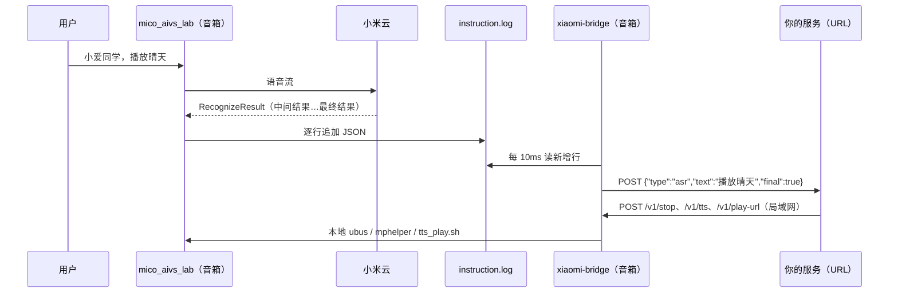

# 研究：刷机音箱上的 xiaomi-bridge

分支：`research/xiaomi-bridge`。目的：评估在刷机后的小爱音箱上运行一个桥接程序，**把识别出的用户语音实时推送到指定 URL**，以及能否在音箱本地**播放 TTS / 打断播放**。

> 状态：代码在本机用模拟日志和模拟命令跑通（`go test`、二进制冒烟）；**未在真机上运行**。所有设备行为来自下列开源项目的源码与 issue，标注了来源；第 7 节是真机验证清单。

## 1. 结论

| 问题 | 结论 |
|---|---|
| 能否实时拿到用户说的话 | 能。小爱语音服务 `mico_aivs_lab` 把云端下发的每条指令逐行写入 `/tmp/mico_aivs_lab/instruction.log`，其中 `SpeechRecognizer.RecognizeResult` 就是识别文本（含说话过程中的中间结果）。轮询该文件即可，不经小米云对话记录接口 |
| 推送延迟 | 本机冒烟：日志写入 → URL 收到 ≈ 11 ms（10 ms 轮询 + 局域网 POST）。真机多出的是 ARM 上的读文件与网络，预计仍在几十毫秒内（未实测） |
| 能否本地播放 TTS | 能，两种：① `ubus call mibrain text_to_speech`（非阻塞，由小爱自己的播放器播放）；② `/usr/sbin/tts_play.sh`（阻塞，合成到文件后由 `miplayer` 播放） |
| 能否打断**我们自己的** TTS | 能。阻塞 TTS：杀掉 `tts_play.sh` **及其子进程 `miplayer`**（bridge 用独立进程组一次杀掉）；非阻塞 TTS：`mphelper pause`（社区反馈"不一定可靠"） |
| 能否打断**小爱原生**回答 | 只能尽力而为。重启 `mico_aivs_lab` 在原生回复**开始播放前**有效、开始后在 LX06 上无效；可靠做法是先 `pause` 再播放、并在每句前再 `pause` |

## 2. 原理



- 识别仍由小米云完成；bridge 省掉的是「云端写对话记录 + 轮询间隔 + 控制指令绕云」三段。
- 日志格式来源：Open-XiaoAI `packages/client-rust/src/services/monitor/instruction.rs`（结构体定义）与 `examples/migpt/migpt/xiaoai.ts`（只取 `is_final` 的 `results[0].text`）。open-speaker-llm/xiaomi_ai_llm 在 S12A 的 boot1 固件上也确认识别文本写入该文件。
- 文件被截断（大小变小）或被替换（inode 变化，服务重启）时从头读；启动时跳过已有内容，不重放历史。

## 3. 代码

| 路径 | 内容 |
|---|---|
| `cmd/xiaomi-bridge/` | 命令行入口 |
| `internal/xiaomibridge/tail.go` | 轮询式 tail（截断、替换、文件尚未生成、半行） |
| `internal/xiaomibridge/instruction.go` | 解析指令行与识别结果 |
| `internal/xiaomibridge/push.go` | 单协程按序推送；不重试（迟到的提问比丢失更糟），队列满丢弃 |
| `internal/xiaomibridge/device.go` | 本地命令：不经 shell 执行，参数原样传递 |
| `internal/xiaomibridge/control.go` | 控制 API（Bearer token） |

构建：`make bridge` → `dist/xiaomi-bridge_linux_armv7`（LX06 / OH2P，Open-XiaoAI 用 `armv7-unknown-linux-gnueabihf`）与 `dist/xiaomi-bridge_linux_arm64`（如 S12A 等 aarch64 机型）。约 7 MB 静态二进制，无依赖。上机前用 `uname -m` 确认架构。

## 4. 推送事件

每条识别结果 `POST <push-url>`，`Content-Type: application/json`；设置了 `XIAOMI_BRIDGE_PUSH_TOKEN` 时带 `Authorization: Bearer <token>`：

```json
{"type":"asr","device":"lx06","dialog_id":"6b1f...","text":"播放晴天","final":true,"ts":1793174811259}
```

- 默认只推 `final:true`；`-partial` 时也推中间结果（可提前开始搜索/打断，需接收方按 `dialog_id` 合并）。
- 同一结果连续出现只推一次。
- 接收方返回任意 2xx 即成功；超时 3 s。

## 5. 控制 API

`-listen` 开启，必须设置 `XIAOMI_BRIDGE_TOKEN`（否则拒绝启动）。除 `/healthz` 外都要 `Authorization: Bearer <token>`。

| 请求 | 设备上执行 | 说明 |
|---|---|---|
| `POST /v1/tts {"text":"…"}` | `ubus call mibrain text_to_speech {"text":…,"save":0}` | 默认 `mode:"async"`，立即返回；由小爱播放器播放，再次唤醒小爱会自动打断 |
| `POST /v1/tts {"text":"…","mode":"blocking"}` | `/usr/sbin/tts_play.sh <text>` | 播完才返回，便于逐句续播；新的 blocking 请求、`/v1/stop`、客户端断开都会打断，返回 `interrupted:true` |
| `POST /v1/play-url {"url":"http://…"}` | `ubus call mediaplayer player_play_url {"url":…,"type":1}` | 仅 http/https |
| `POST /v1/stop` | 杀阻塞 TTS 进程组 → `mphelper pause` → `ubus call mediaplayer player_play_operation {"action":"stop"}` | `interrupted` 表示是否打断了阻塞 TTS；暂停/停止失败放在 `warning` |
| `POST /v1/abort-xiaoai` | `/etc/init.d/mico_aivs_lab restart` | 丢弃小爱当前对话；有副作用，见下节 |
| `GET /v1/status` | `mphelper mute_stat` | `playing` / `paused` / `idle` |

所有命令都用参数数组执行，不经 shell：TTS 文本里的引号、`$(…)` 原样传给 ubus（有测试覆盖）。Open-XiaoAI 原版是把整段 shell 脚本交给 `run_shell` 执行，任何连上的服务端都能在音箱上执行任意命令；本 bridge 只暴露上表这几个操作。

## 6. 打断与播放 TTS 的调研

音箱上有多条互相独立的播放通道，要分别处理（open-xiaoai-bridge `AGENTS.md`）：

| 通道 | 进程 | 怎么播 | 怎么停 |
|---|---|---|---|
| 阻塞 TTS | `tts_play.sh` → `miplayer -f <文件>` | `tts_play.sh '<文本>'` | 杀 `tts_play.sh` **和** `miplayer`；只杀脚本不会停子进程；busybox `pkill` 匹配不到 `miplayer`，要用 `killall` |
| 非阻塞 TTS | `mibrain` 内部播放 | `ubus call mibrain text_to_speech` | `mphelper pause`（不一定可靠）；`player_play_operation pause` 对它**无效** |
| 媒体播放器 | `mediaplayer` 守护进程 | `ubus call mediaplayer player_play_url` | `mphelper pause` / `player_play_operation` |
| PCM 直通 | `aplay` | 推音频流 | 停止推流 |

`tts_play.sh` 内部流程：`mphelper pause` → `text_to_speech save:1` 合成到 `/tmp/tts/` → `miplayer -f` 播放 → 删除文件。

bridge 的取舍：

- **阻塞 TTS 用独立进程组**（`Setpgid`），`/v1/stop` 对整组发 `SIGKILL`，`tts_play.sh` 与 `miplayer` 一起结束，不依赖 `killall`。cxjava/open-xiaoai 的 Go 客户端也是「取消当前 TTS 进程 + `mphelper pause` + 停播放器」的组合（其 `stopNativePlaybackScript` 用的是 `ubus call mediaplayer player_stop`，本实现沿用 vox 已在用的 `player_play_operation stop`；真机上哪个有效待验证）。
- **原生回答打断**：
  - `mico_aivs_lab restart`：Open-XiaoAI 作者注明重启需 1–2 s，期间小爱 TTS 不可用；issue #36 中两位 LX06 用户反馈原生回复**已开始播放后**无法打断，会与自定义回复同时播放。open-xiaoai-bridge 也把它列为"不可靠或有副作用"。
  - 社区可行做法（issue #36）：一开始就循环 `pause`（约 100 ms 一次，持续到自己的回答准备好），自己的回答按句拆分，每句播完再 `pause` 一次。由于非阻塞 TTS 由小爱自己维护播放状态，用户再次唤醒时会自动停掉我们的 TTS（Open-XiaoAI 作者的说明）。
  - 更彻底的只有逆向接管小爱服务：open-speaker-llm/xiaomi_ai_llm 做过 mipns↔aivs 本地 socket 的中间人，记录了协议与"aivs 的对话状态是权威"的结论，代价和风险都高，不在本分支范围。
- **唤醒小爱时停掉我们的阻塞 TTS**：需要监听唤醒事件（Open-XiaoAI 的 `kws` 监控或 instruction.log 中新的 `dialog_id`），本分支未做；接收方收到新的 `asr` 事件后调用 `/v1/stop` 即可达到相近效果。
- cxjava/open-xiaoai 在播放阻塞 TTS 前后调用 `ubus call pnshelper event_notify {"src":3,"event":12}` / `event:13`（推测为告知前端"正在播报"，用于压低音量或回声消除），含义未查证，本分支未采用。

## 7. 真机验证清单

前提：LX06 或 OH2P 已按 Open-XiaoAI `docs/flash.md` 刷入对应版本的补丁固件（OH2P v1.58.6、LX06 v1.94.13；跨版本可能变砖），SSH 可用。

部署（dropbear 只认 ssh-rsa；音箱可能没有 scp）：

```sh
uname -m   # 在音箱上：armv7l → armv7 包；aarch64 → arm64 包
ssh -o HostKeyAlgorithms=+ssh-rsa root@<音箱IP> "mkdir -p /data/xiaomi-bridge && cat > /data/xiaomi-bridge/xiaomi-bridge && chmod +x /data/xiaomi-bridge/xiaomi-bridge" < dist/xiaomi-bridge_linux_armv7
```

开机自启（追加到补丁固件会执行的 `/data/init.sh`）：

```sh
export XIAOMI_BRIDGE_TOKEN='<随机长串>'
export XIAOMI_BRIDGE_PUSH_TOKEN='<接收方校验用>'
/data/xiaomi-bridge/xiaomi-bridge -device lx06 \
  -push-url http://<NAS>:<端口>/<路径> -listen 0.0.0.0:4390 \
  >> /tmp/xiaomi-bridge.log 2>&1 &
```

需要在真机上确认的事项：

1. `instruction.log` 每行是否为纯 JSON（或带前缀），最终结果是否只出现一次；中间结果的频率。
2. 日志是否会被轮转/截断，`mico_aivs_lab` 重启后是否新建文件（bridge 两种情况都处理了）。
3. 从说完话到收到推送的实际延迟（用 `ts` 与接收时间对比；对照 vox 现有日志里的 `ask_lag_ms`）。
4. `/v1/tts` 两种模式是否发声；阻塞模式下 `/v1/stop` 是否立刻静音、`miplayer` 是否消失（`ps | grep miplayer`）。
5. 非阻塞 TTS 播放中 `/v1/stop` 是否有效；`player_play_operation stop` 与 `player_stop` 哪个有效。
6. 原生回答：收到推送后立即 `/v1/stop`，原生回复是否还会插入；与"循环 pause"方案对比。
7. `mphelper mute_stat` 的实际输出格式（目前按 Open-XiaoAI 的「含 1 = 播放、含 2 = 暂停」判断）。
8. `/data` 剩余空间（二进制约 7 MB）与内存占用。

## 8. 风险

- 刷机：仅 LX06 / OH2P 有现成固件；旧款 LX06 需拆机；补丁关闭了 OTA；Open-XiaoAI 已停止维护，新固件版本可能不兼容。
- 安全：控制 API 能让音箱发声和播放任意 URL。只在可信局域网开放，token 用长随机串；默认 SSH 密码 `open-xiaoai` 要改掉。推送为明文 HTTP，内容是家里人说的话。
- `instruction.log` 是小米内部实现，固件版本变化可能改格式或路径。

## 9. 接入 vox-mi-agent 的下一步（未做）

- 新增推送式接收端点（例如 `POST /api/speaker/bridge/asr`，按 token 识别设备），收到 `final` 事件直接进入 `Hook.handle`，替代 `poll` 循环里的 `GetLatestAsk`。
- 新增 `speaker.Driver` 实现，`TextToSpeech` / `PlayByURL` / `PlayerPause` / `PlayerStop` / `PlayerGetStatus` 改为调用 bridge 的控制 API；`interrupt` 改为"收到推送立即 stop + 首句前循环 pause"。
- 播放本地歌曲仍用 `PlayByURL` 指向 NAS 上的签名 URL，音箱直连 NAS，不经小米云。

## 参考

- Open-XiaoAI：<https://github.com/idootop/open-xiaoai>（刷机 `docs/flash.md`、Rust 客户端 `packages/client-rust`、issue #36）
- cxjava/open-xiaoai（Go 版客户端，`apps/client/utils/shell.go`）：<https://github.com/cxjava/open-xiaoai>
- open-xiaoai-bridge（播放通道与中断方式整理）：<https://github.com/coderzc/open-xiaoai-bridge/blob/main/AGENTS.md>
- open-speaker-llm/xiaomi_ai_llm（S12A，aivs/mipns 本地协议逆向）：<https://github.com/open-speaker-llm/xiaomi_ai_llm>
